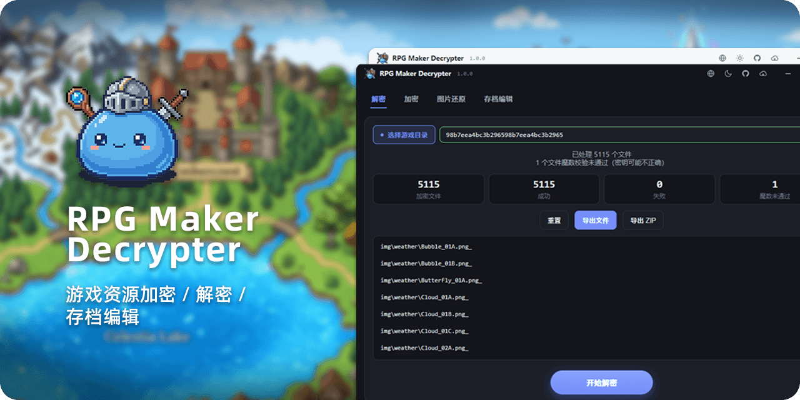

<div align="center">

<p></p>

<p>
<a href="https://github.com/LynxShu/RPGMakerDecrypter/releases"></a>&nbsp;
<a href="https://github.com/LynxShu/RPGMakerDecrypter/releases"></a>&nbsp;
<a href="https://github.com/LynxShu/RPGMakerDecrypter/releases"></a>&nbsp;
<a href="./skills/rpgmaker-decrypter/SKILL.md"></a>&nbsp;
<a href="https://github.com/LynxShu/RPGMakerDecrypter/blob/main/LICENSE"></a>
</p>

<h3>简体中文 &nbsp; / &nbsp; <a href="README_en.md">English</a> &nbsp; / &nbsp; <a href="README_jp.md">日本語</a></h3>

**RPG Maker MV / MZ** 游戏资源解密、加密、无密钥救图与工程恢复工具

</div>

> [!NOTE]
> `v1.0.3` 为本项目功能完结的最终版本，后续进入维护模式，原则上不再新增功能。
> 旧版 Python 源码已归档，如需使用请前往 [Original Build (v0.1-beta.1)](https://github.com/LynxShu/RPGMakerDecrypter/releases/tag/v0.1-beta.1)。

---

## ✨ 功能一览

| 功能 | 说明 |
| --- | --- |
| **资源解密 / 加密** | 支持 MV（`.rpgmvp / .rpgmvo / .rpgmvm`）与 MZ（`.png_ / .ogg_ / .m4a_`）图片与音频资源 |
| **一键导出工程** | 从 MV / MZ 发行版直接还原出可被编辑器打开的 `<目录名>_project` 工程（过滤 NW.js 运行时、解除加密标志、补齐 `.rpgproject` / `.rmmzproject`，保留插件目录，绝不改动原游戏目录） |
| **无密钥救图** | 没有密钥也能通过重建标准 PNG 文件头恢复加密图片 |
| **密钥自动识别** | 按 `System.json` → `rpg_core.js` → 加密 PNG 头反推的优先级自动找 key，并对解密结果做魔数校验 |
| **高性能批处理** | 多线程解密、实时进度、随时取消、单文件超时自动跳过；大目录流式扫描与虚拟列表渲染 |
| **灵活导出** | 支持导出明文文件目录、打包 `ZIP`，或直接还原为可编辑工程 |
| **多语言 & 主题** | 内置简体中文 / 繁體中文 / English / 日本語，首次启动自动匹配系统语言；支持热重载自定义语言包与明暗主题 |
| **CLI & AI Skill** | 提供完整命令行工具，并随仓库附带英文版 [AI Skill](skills/rpgmaker-decrypter/SKILL.md)，方便配合 AI 助手直接使用 |

---

## ⚡ 使用方式

### 1. 桌面版（推荐，Windows 绿色免安装）

1. 前往 [GitHub Releases](https://github.com/LynxShu/RPGMakerDecrypter/releases) 下载最新版压缩包。
2. 解压到任意可写目录（不建议放到 `C:\Program Files` 等需要管理员权限的位置）。
3. 双击 `RPGMakerDecrypter.exe` 启动。

**基本操作**
- **解密 / 导出工程**：选择游戏目录 → 点击「开始解密」（自动扫描、找 key 并解密到缓存）→ 按需点击「导出文件」「导出工程」或「导出 ZIP」→ 完成后可直接点击「打开输出目录」；点击「重置」清空缓存。
  > 未加密的完整 MV / MZ 游戏扫描完成后，也可直接点击「导出工程」。
- **加密 / 图片还原**：切换到对应标签页，拖入或选择文件 / 目录与输出路径，一键批量处理。

### 2. 命令行（CLI）

适合批量自动化或脚本集成（开发环境可用 `npm run cli -- <命令>`，构建后可直接 `node out/main/cli.js <命令>`）：

```bash
# 自动查找游戏目录密钥
rpgmaker-decrypter detect-key <dir>

# 批量解密整个游戏目录（自动找 key，保留目录结构）
rpgmaker-decrypter decode-dir <dir> [-k <key>] [-o <out>] [--dry-run] [--jobs 8] [--json]

# 将 MV/MZ 发行版还原为可编辑工程（默认输出同级 <目录名>_project）
rpgmaker-decrypter export-project <dir> [-k <key>] [-o <out>] [--dry-run] [--jobs 8] [--json]

# 单文件解密 / 加密 / 无密钥救图
rpgmaker-decrypter decrypt <file> -k <key> [-o <out>] [--ignore-fake-header] [--json]
rpgmaker-decrypter encrypt <file> -k <key> [-f mv|mz] [-o <out>] [--json]
rpgmaker-decrypter restore <file> [-o <out>] [--json]
```

通用选项：`--json`（JSON 输出，放在子命令前后均可）、`--verbose`（详细过程日志）、`--lang <code>`（指定语言，缺失时回退英文）。

### 3. 配合 AI 助手使用（AI Skill）

如果你习惯直接让 AI Coding Agent（如 Claude Code、Codex、Cursor、Antigravity 等）帮你处理文件，仓库内置了一份开箱即用的 Skill：

- 路径：[`skills/rpgmaker-decrypter/SKILL.md`](skills/rpgmaker-decrypter/SKILL.md)

该 Skill 完整记录了 RPG Maker MV / MZ 的加密头结构、XOR 规则、密钥反推、PNG 头恢复、工程重建细节以及零依赖 Python 参考实现，AI 可以依据原理直接编写脚本或调用本仓库 CLI 完成处理。

---

## 🌐 自定义语言包

语言包是标准 JSON 文件，修改后**实时热生效，无需重启**。

1. 找到语言包模板 `_template.json`：
   - 绿色版：`<程序目录>\rpgmaker-decrypter\locales\_template.json`（若程序目录不可写，则位于 `%APPDATA%\rpgmaker-decrypter\locales\`）
   - 源码版：`locales/_template.json`
2. 复制一份并重命名为目标语言代码（如 `fr.json`、`ko.json`）。
3. 修改文件顶部的 `"__meta": { "name": "…" }` 为你想在菜单里显示的名称，翻译需要的字段后保存即可。未翻译的字段会自动回退英文。

---

## 💾 数据存放位置

Windows 打包版默认将所有数据存放在 `<程序目录>\rpgmaker-decrypter\`，整个文件夹可直接放进 U 盘随身携带：

| 路径 | 用途 |
| --- | --- |
| `config.json` | 界面语言、主题等偏好设置 |
| `history.json` | 最近项目与密钥记录 |
| `locales\` | 自定义语言包目录 |
| `cache\` | 解密临时缓存（退出或下次启动时自动清理） |

- **自动回退**：程序位于 `Program Files` 或其他只读目录时，自动回退至 `%APPDATA%\rpgmaker-decrypter\`（临时缓存位于 `%TEMP%\rpgmaker-decrypter`）。
- **环境变量覆盖**：设置绝对路径环境变量 `RPGMD_DATA_DIR` 可在任意模式下强制指定数据目录。

---

## 🧪 开发与构建

环境要求：Node.js ≥ 20（推荐 22）、npm ≥ 10。

```bash
npm install          # 安装依赖
npm run dev          # 开发模式（热更新）
npm run typecheck    # TypeScript 类型检查
npm test             # Vitest 单元测试
npm run cli:test     # CLI 自动化校验
npm run build        # 构建应用与 CLI 到 out/
npm run package:dir  # 生成 Windows 绿色版到 release/win-unpacked/
```

---

## 🤝 特别鸣谢

本项目在设计与实现中参考了以下开源项目：

- [Petschko/RPG-Maker-MV-Decrypter](https://github.com/Petschko/RPG-Maker-MV-Decrypter)
- [pieroxy/lz-string](https://github.com/pieroxy/lz-string)
- [RPG-Maker-Translation-Tools/rpgmdec](https://github.com/RPG-Maker-Translation-Tools/rpgmdec)
- [RPG-Maker-Translation-Tools/rpgm-archive-decrypter](https://github.com/RPG-Maker-Translation-Tools/rpgm-archive-decrypter)
- [RPG-Maker-Translation-Tools/rpgm-asset-decrypter-rs](https://github.com/RPG-Maker-Translation-Tools/rpgm-asset-decrypter-rs)
- [Petschko/Java-RPG-Maker-MV-Decrypter](https://github.com/Petschko/Java-RPG-Maker-MV-Decrypter)
- [omega-slender/NimRpgMakerDecrypt](https://github.com/omega-slender/NimRpgMakerDecrypt)

---

## ⚖️ 免责声明

> [!WARNING]
> **本工具仅供找回个人丢失工程、学习研究与获得授权的本地化 / 改模（Modding）使用。**

- 请勿使用本工具窃取资源或侵犯游戏开发者的知识产权。
- 请尊重所操作软件及游戏的版权与许可条款。
- 作者对因使用本软件而产生的任何滥用行为或法律后果不承担责任。

## 📜 许可证

本项目基于 **MIT** 许可证开源，详见 [LICENSE](LICENSE)。
