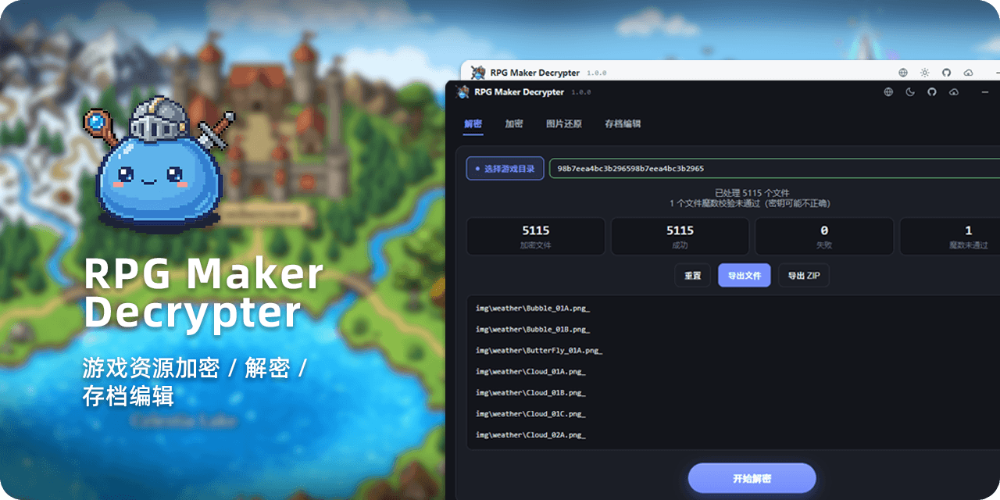

<div align="center">

<p></p>

<p>
<a href="https://github.com/LynxShu/RPGMakerDecrypter/releases"></a>&nbsp;
<a href="https://github.com/LynxShu/RPGMakerDecrypter/releases"></a>&nbsp;
<a href="https://github.com/LynxShu/RPGMakerDecrypter/releases"></a>&nbsp;
<a href="https://github.com/LynxShu/RPGMakerDecrypter/blob/main/LICENSE"></a>
</p>

<h3><p>简体中文 &nbsp; / &nbsp; <a href="README_en.md">English</a> &nbsp; / &nbsp; <a href="README_jp.md">日本語</a></p></h3>

**RPG Maker MV / MZ** 游戏资源的解密、加密、存档编辑工具

</div>


## 📖 1. 项目简介

- 本工具用于从 RPG Maker MV / MZ 游戏中解密或重新加密资源，并支持编辑游戏存档，适用于找回自己丢失的项目文件、获得授权的改模与学习研究。
- 更多功能及易用性改进将持续进行...

> [!TIP]
> 旧版 Python 程序源码已经归档，如需使用请下载 [Original Build](https://github.com/LynxShu/RPGMakerDecrypter/releases/tag/v0.1-beta.1)

## ✨ 2. 功能特性

- **解密 / 加密**：MV `.rpgmvp / .rpgmvo / .rpgmvm` 与 MZ `.png_ / .ogg_ / .m4a_` 资源文件。
- **图片恢复**：即使没有加密密钥，也能通过重建 PNG 文件头恢复图片。
- **密钥反推**：从 `System.json`、`rpg_core.js` 或加密图片头反推密钥。
- **批量与性能**：多线程解密，实时进度、可取消、单文件超时自动跳过；超大目录流式扫描、渐进渲染。
- **导出**：解密结果可导出为文件目录或打包为 `ZIP`。
- **存档编辑器**：MV / MZ 存档解码，`快捷修改` 与 `JSON 树` 双视图编辑，写回前自动备份 `.bak`。
- **多语言**：内置中文 / English / 日本語，支持**自定义语言包**。
- **主题**：明暗主题。
- **命令行**：完整 CLI，便于批量自动化。

## ⚡ 3. 快速使用

1. **下载**：打开 [GitHub Releases](https://github.com/LynxShu/RPGMakerDecrypter/releases)，下载压缩包。
2. **解压**：解压到任意目录（建议不要解压到需要管理员权限的位置，如 `C:\Program Files`）。
3. **运行**：进入解压后的文件夹，双击 `RPGMakerDecrypter.exe` 即可运行。

## 🚀 4. 使用指南

### 1️⃣ 解密资源

1. 选择游戏目录，点「开始解密」——自动扫描加密文件、查找密钥并做 key 预检。
2. 查看统计后，选择「导出文件」（拷贝到目录）或「导出 ZIP」（打包）。
3. 点「重置」清空本次缓存。

### 2️⃣ 加密 / 无密钥图片恢复

切换到对应标签，选择文件/目录与输出目录，进行单/批量处理。

### 3️⃣ 存档编辑器

选择存档目录或单个存档文件，用快捷表单或 JSON 树编辑，保存时自动备份。

### 4️⃣ 命令行（CLI）

```bash
# 资源
rpgmaker-decrypter decrypt <file> -k <key> [-o out] [--json]
rpgmaker-decrypter encrypt <file> -k <key> [-o out]
rpgmaker-decrypter restore <file> [-o out]                       # 无密钥图片恢复
rpgmaker-decrypter detect-key <dir>                               # 自动找 key
rpgmaker-decrypter decode-dir <dir> [-k key] [-o out] [--dry-run] [--jobs 8]

# 存档
rpgmaker-decrypter save-decode <file> [-o out.json]
rpgmaker-decrypter save-encode <json> <out.rpgsave|out.rmmzsave> [--kind mv|mz]
```

通用选项：`--json`（机器可读输出）、`--verbose`（更多过程信息）、`--lang <code>`（界面语言，找不到回退英文）。

开发环境下可用 `npm run cli -- <args>` 代替 `rpgmaker-decrypter`。

## 🌐 5. 自定义语言包

语言包是一个 JSON 文件。项目自带一份完整模版，修改完毕后**立即生效、无需重启软件**。

### 添加新语言

1. **复制**：把 `_template.json` 复制一份，重命名为目标语言名称，如 `fr.json`、`de.json`。
   - 源码版：模版在项目根目录 `locales/_template.json`；
   - 打包版（绿色版）：模版默认在 `<程序目录>\rpgmaker-decrypter\locales\`；
   - 若程序目录不可写（如放在 `C:\Program Files` 或只读磁盘），则回退到 `%APPDATA%\rpgmaker-decrypter\locales\`。
2. **改名**：文件开头的 `"__meta": { "name": "…" }` 改成语言名称（会显示在软件右上角语言下拉框中），如 `"Français"`。
3. **翻译**：把每个 key 后面引号里的英文改成你的语言，保存即可。下拉框里马上出现新语言。

> [!NOTE]
> 模版含**全部**文案 key；可以只保留想要修改的键值，不存在的键值将会自动回退英文。

## 💾 数据存放位置（便携模式）

Windows 打包版（绿色版）默认把应用数据保存在 `<程序目录>\rpgmaker-decrypter\`，整个文件夹可随程序一起放在 U 盘或移动硬盘中携带：

| 路径 | 用途 |
| --- | --- |
| `config.json` | 界面语言、主题等偏好设置 |
| `history.json` | 最近项目与密钥历史 |
| `locales\` | 自定义语言包（见上一节） |
| `cache\` | 解密临时缓存，退出或启动时自动清理 |

- **回退**：若程序目录不可写（如放在 `C:\Program Files` 或只读磁盘），则改用系统默认的 `%APPDATA%\rpgmaker-decrypter\`。
- **首次便携启动**：若目标目录尚不存在，会把 `%APPDATA%\rpgmaker-decrypter` 中已有的 `config.json`、`history.json` 和 `locales\` 迁移过来，仅补齐缺失项，不覆盖已有文件。
- **环境变量覆盖**：把环境变量 `RPGMD_DATA_DIR` 设为绝对路径可强制指定数据目录，在任何模式下都生效；开发模式未设置时使用系统默认目录。
- **缓存**：便携模式下临时缓存位于数据目录的 `cache\`，其他情况位于 `%TEMP%\rpgmaker-decrypter`。
- macOS / Linux 没有便携模式，始终使用系统默认目录。

## 🧪 开发与测试

```bash
npm run typecheck    # TS 类型检查
npm test             # vitest 单元测试
node scripts/verify.cjs               # 核心自检（需先 tsc -p tsconfig.build-lib.json）
node scripts/regression.cjs           # 合成样本端到端
node scripts/verify-cli.cjs           # CLI 自动化（需先 prepare-cli-test.cjs）
node scripts/verify-watch.cjs         # 热监视/偏好存储回归
```

### 环境要求与运行
- Node.js ≥ 20（建议 22）
- npm ≥ 10

```bash
npm install          # 安装依赖
npm run dev          # 开发运行（热更新）
npm run build        # 构建到 out/
npm run package:dir  # 生成免安装目录 release/win-unpacked/（含 .exe）
npm run package      # 生成安装程序（NSIS）
```

## 🤝 特别鸣谢

本项目在设计与实现中参考了以下开源项目：

- [Petschko/RPG-Maker-MV-Decrypter](https://github.com/Petschko/RPG-Maker-MV-Decrypter)
- [pieroxy/lz-string](https://github.com/pieroxy/lz-string)
- [takuyaihara/rpgsave-editor](https://github.com/takuyaihara/rpgsave-editor)
- [Gteditor99/rpgsave-decode](https://github.com/Gteditor99/rpgsave-decode)
- [RPG-Maker-Translation-Tools/rpgmdec](https://github.com/RPG-Maker-Translation-Tools/rpgmdec)
- [RPG-Maker-Translation-Tools/rpgm-archive-decrypter](https://github.com/RPG-Maker-Translation-Tools/rpgm-archive-decrypter)
- [RPG-Maker-Translation-Tools/rpgm-asset-decrypter-rs](https://github.com/RPG-Maker-Translation-Tools/rpgm-asset-decrypter-rs)
- [Petschko/Java-RPG-Maker-MV-Decrypter](https://github.com/Petschko/Java-RPG-Maker-MV-Decrypter)
- [omega-slender/NimRpgMakerDecrypt](https://github.com/omega-slender/NimRpgMakerDecrypt)
- [paradoxie/saveeditor](https://github.com/paradoxie/saveeditor)
- [LackoPotato/RPGMakerMVSaveEditor](https://github.com/LackoPotato/RPGMakerMVSaveEditor)

## ⚖️ 免责声明

> [!WARNING]
> **本工具仅供学习研究、文件恢复和获得授权的改模（Modding）使用。**

- 请勿使用本工具窃取资源或以任何方式侵犯游戏开发者的知识产权。
- 请尊重所操作软件或游戏的版权及使用条款。
- 作者对因使用本软件而产生的任何滥用行为或法律后果不承担任何责任。

## 📜 许可证

本项目采用 **MIT** 许可证。
