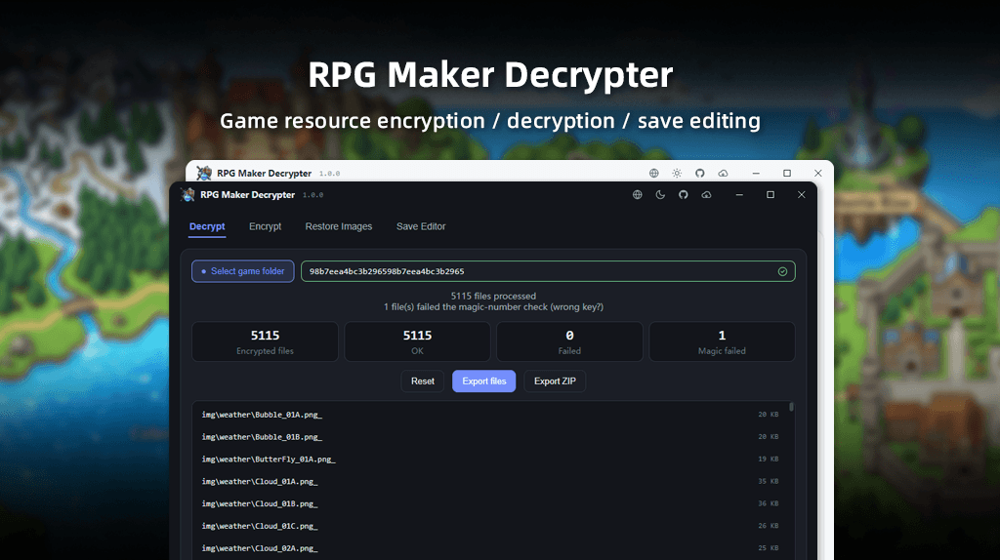

<div align="center">

<p></p>

<p>
<a href="https://github.com/LynxShu/RPGMakerDecrypter/releases"></a>&nbsp;
<a href="https://github.com/LynxShu/RPGMakerDecrypter/releases"></a>&nbsp;
<a href="https://github.com/LynxShu/RPGMakerDecrypter/releases"></a>&nbsp;
<a href="https://github.com/LynxShu/RPGMakerDecrypter/blob/main/LICENSE"></a>
</p>

<h3><p><a href="README.md">简体中文</a> &nbsp; / &nbsp; English &nbsp; / &nbsp; <a href="README_jp.md">日本語</a></p></h3>

**RPG Maker MV / MZ** game resource decryption, encryption, and save-editing tool

</div>


## 📖 1. Introduction

- This tool decrypts or re-encrypts resources from RPG Maker MV / MZ games and can also edit game save files. It is intended for recovering your own lost project files, authorized modding, and learning/research.
- More features and usability improvements are on the way...

> [!TIP]
> The old Python program source has been archived. To use it, download the [Original Build](https://github.com/LynxShu/RPGMakerDecrypter/releases/tag/v0.1-beta.1)

## ✨ 2. Features

- **Decrypt / Encrypt**: MV `.rpgmvp / .rpgmvo / .rpgmvm` and MZ `.png_ / .ogg_ / .m4a_` asset files.
- **Image recovery**: recover images by rebuilding the PNG header even without an encryption key.
- **Key inference**: derive the key from `System.json`, `rpg_core.js`, or the encrypted image header.
- **Bulk & performance**: multithreaded decryption with real-time progress, cancellable, and a per-file timeout that automatically skips; streamed scanning and progressive rendering for very large folders.
- **Export**: export the decrypted results to a folder or package them as a `ZIP`.
- **Save editor**: decode MV / MZ save files with both a quick-editor and a JSON tree view, with an automatic `.bak` backup before writing back.
- **Multilingual**: built-in 简体中文 / English / 日本語, plus support for **custom language packs**.
- **Theme**: light and dark themes.
- **CLI**: a complete command-line interface for batch automation.

## ⚡ 3. Quick Start

1. **Download**: open [GitHub Releases](https://github.com/LynxShu/RPGMakerDecrypter/releases) and download the archive.
2. **Extract**: extract it to any folder (preferably not a location that requires administrator rights, such as `C:\Program Files`).
3. **Run**: open the extracted folder and double-click `RPGMakerDecrypter.exe`.

## 🚀 4. Usage Guide

### 1️⃣ Decrypting resources

1. Select the game folder and click "Start Decrypt" — encrypted files are scanned, the key is found, and a key pre-check is performed automatically.
2. After reviewing the stats, choose "Export files" (copy to a folder) or "Export ZIP" (archive).
3. Click "Reset" to clear this session's cache.

### 2️⃣ Encrypting / recovering images without a key

Switch to the corresponding tab, select files/folders and an output folder, then process them individually or in batch.

### 3️⃣ Save editor

Select a save folder or a single save file, edit with the quick form or the JSON tree, and a backup is created automatically when saving.

### 4️⃣ Command line (CLI)

```bash
# Assets
rpgmaker-decrypter decrypt <file> -k <key> [-o out] [--json]
rpgmaker-decrypter encrypt <file> -k <key> [-o out]
rpgmaker-decrypter restore <file> [-o out]                        # image recovery without a key
rpgmaker-decrypter detect-key <dir>                               # auto-detect the key
rpgmaker-decrypter decode-dir <dir> [-k key] [-o out] [--dry-run] [--jobs 8]

# Saves
rpgmaker-decrypter save-decode <file> [-o out.json]
rpgmaker-decrypter save-encode <json> <out.rpgsave|out.rmmzsave> [--kind mv|mz]
```

Common options: `--json` (machine-readable output), `--verbose` (more detail), `--lang <code>` (interface language; falls back to English if not found).

In a development environment, use `npm run cli -- <args>` instead of `rpgmaker-decrypter`.

## 🌐 5. Custom Language Packs

A language pack is a JSON file. The project ships a complete template; after you modify it, it **takes effect immediately — no need to restart the app**.

### Adding a new language

1. **Copy**: duplicate `_template.json` and rename it to the target language name, e.g. `fr.json`, `de.json`.
   - From source: the template is at the project root, `locales/_template.json`;
   - Packaged (portable) app: the template is in `<program folder>\rpgmaker-decrypter\locales\`;
   - If the program folder is not writable (e.g. under `C:\Program Files` or a read-only drive), it falls back to `%APPDATA%\rpgmaker-decrypter\locales\`.
2. **Rename**: change `"__meta": { "name": "…" }` at the top of the file to the language's own name (shown in the language dropdown in the top-right corner), e.g. `"Français"`.
3. **Translate**: replace the English text in quotes after each key with your language and save. The new language appears in the dropdown immediately.

> [!NOTE]
> The template contains **all** message keys. You can keep only the keys you want to change; missing keys automatically fall back to English.

## 💾 Data location (portable mode)

The packaged Windows app (portable build) keeps its data in `<program folder>\rpgmaker-decrypter\`, so the whole folder can travel with the app on a USB stick or external drive:

| Path | Contents |
| --- | --- |
| `config.json` | UI language, theme, and other preferences |
| `history.json` | Recent projects and key history |
| `locales\` | Custom language packs (see the previous section) |
| `cache\` | Temporary decryption cache, cleaned up automatically on exit/start |

- **Fallback**: if the program folder is not writable (e.g. under `C:\Program Files` or a read-only drive), the system default `%APPDATA%\rpgmaker-decrypter\` is used instead.
- **First portable launch**: if the target folder did not exist yet, existing `config.json`, `history.json` and `locales\` are migrated from `%APPDATA%\rpgmaker-decrypter`; missing entries only, existing files are never overwritten.
- **Environment override**: set `RPGMD_DATA_DIR` to an absolute path to force the data directory in every mode; without it, development mode uses the system default.
- **Cache**: in portable mode the temporary cache lives in the data folder's `cache\`; otherwise it is placed in `%TEMP%\rpgmaker-decrypter`.
- macOS / Linux have no portable mode and always use the system default data folder.

## 🧪 Development & Testing

```bash
npm run typecheck    # TypeScript type check
npm test             # vitest unit tests
node scripts/verify.cjs               # core self-check (run `tsc -p tsconfig.build-lib.json` first)
node scripts/regression.cjs           # end-to-end with synthetic samples
node scripts/verify-cli.cjs           # CLI automation (run prepare-cli-test.cjs first)
node scripts/verify-watch.cjs         # hot-reload / preferences regression
```

### Requirements & running
- Node.js ≥ 20 (22 recommended)
- npm ≥ 10

```bash
npm install          # install dependencies
npm run dev          # development run (hot reload)
npm run build        # build to out/
npm run package:dir  # generate a portable folder release/win-unpacked/ (contains .exe)
npm run package      # generate the installer (NSIS)
```

## 🤝 Acknowledgments

This project references the following open-source projects in its design and implementation:

- [Petschko/RPG-Maker-MV-Decrypter](https://github.com/Petschko/RPG-Maker-MV-Decrypter)
- [pieroxy/lz-string](https://github.com/pieroxy/lz-string)
- [takuyaihara/rpgsave-editor](https://github.com/takuyaihara/rpgsave-editor)
- [Gteditor99/rpgsave-decode](https://github.com/Gteditor99/rpgsave-decode)
- [RPG-Maker-Translation-Tools/rpgmdec](https://github.com/RPG-Maker-Translation-Tools/rpgmdec)
- [RPG-Maker-Translation-Tools/rpgm-archive-decrypter](https://github.com/RPG-Maker-Translation-Tools/rpgm-archive-decrypter)
- [RPG-Maker-Translation-Tools/rpgm-asset-decrypter-rs](https://github.com/RPG-Maker-Translation-Tools/rpgm-asset-decrypter-rs)
- [Petschko/Java-RPG-Maker-MV-Decrypter](https://github.com/Petschko/Java-RPG-Maker-MV-Decrypter)
- [omega-slender/NimRpgMakerDecrypt](https://github.com/omega-slender/NimRpgMakerDecrypt)
- [paradoxie/saveeditor](https://github.com/paradoxie/saveeditor)
- [LackoPotato/RPGMakerMVSaveEditor](https://github.com/LackoPotato/RPGMakerMVSaveEditor)

## ⚖️ Disclaimer

> [!WARNING]
> **This tool is intended for learning/research, file recovery, and authorized modding only.**

- Do not use this tool to steal assets or otherwise infringe on game developers' intellectual property.
- Respect the copyright and terms of use of the software or games you work with.
- The author assumes no responsibility for any misuse or legal consequences arising from the use of this software.

## 📜 License

This project is licensed under the **MIT** License.
