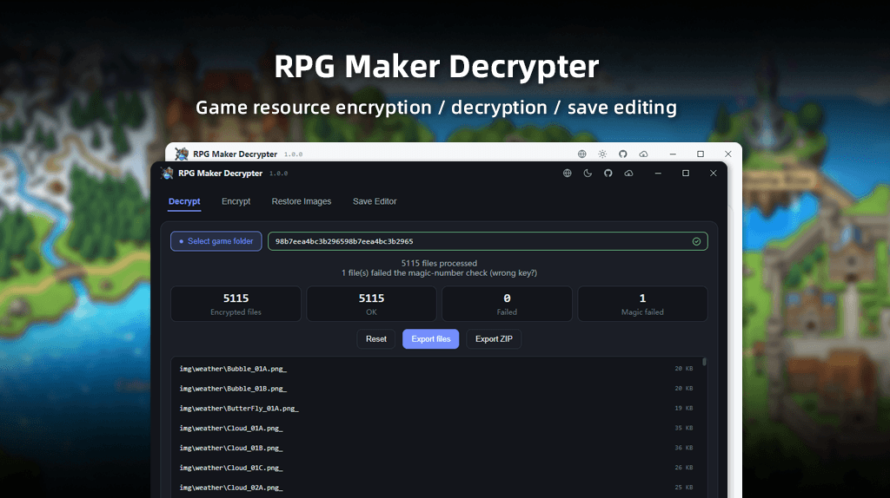

<div align="center">

<p></p>

<p>
<a href="https://github.com/LynxShu/RPGMakerDecrypter/releases"></a>&nbsp;
<a href="https://github.com/LynxShu/RPGMakerDecrypter/releases"></a>&nbsp;
<a href="https://github.com/LynxShu/RPGMakerDecrypter/releases"></a>&nbsp;
<a href="./skills/rpgmaker-decrypter/SKILL.md"></a>&nbsp;
<a href="https://space.bilibili.com/582462"></a>&nbsp;
<a href="https://github.com/LynxShu/RPGMakerDecrypter/blob/main/LICENSE"></a>
</p>

<h3><a href="README.md">简体中文</a> &nbsp; / &nbsp; English &nbsp; / &nbsp; <a href="README_jp.md">日本語</a></h3>

**RPG Maker MV / MZ** asset decrypter, encryptor, keyless PNG restorer & project reconstructor

</div>

> [!NOTE]
> `v1.0.3` is the final feature-complete release. The project is now in maintenance mode with no further feature additions planned.
> The legacy Python implementation has been archived — download it from [Original Build (v0.1-beta.1)](https://github.com/LynxShu/RPGMakerDecrypter/releases/tag/v0.1-beta.1).

---

## ✨ Features

| Feature | Description |
| --- | --- |
| **Decrypt / Encrypt** | Supports MV (`.rpgmvp / .rpgmvo / .rpgmvm`) and MZ (`.png_ / .ogg_ / .m4a_`) image and audio assets |
| **Export Editable Project** | Reconstructs an editable `<folder>_project` from deployed MV / MZ games (filters NW.js runtime files, clears encryption flags in `System.json`, generates `.rpgproject` / `.rmmzproject`, preserves custom plugin directories, and never modifies the original game folder) |
| **Keyless PNG Restore** | Recovers encrypted PNG images without a key by rebuilding the standard PNG header |
| **Automatic Key Detection** | Locates keys via `System.json` → `rpg_core.js` → encrypted PNG header derivation, with magic-byte verification on decrypted outputs |
| **High-Performance Batching** | Multi-threaded worker pool, real-time progress, instant cancellation, per-file timeout skip, streaming directory scan, and virtualized file list |
| **Flexible Export** | Export decrypted files to a folder, pack into a `ZIP` archive, or reconstruct a full editable project |
| **i18n & Themes** | Built-in Simplified Chinese / Traditional Chinese / English / Japanese with first-launch OS language detection, hot-reloading custom language packs, and light/dark themes |
| **CLI & AI Skill** | Full command-line interface plus a bundled [AI Skill](skills/rpgmaker-decrypter/SKILL.md) for direct use with AI coding agents |

---

## ⚡ Usage

### 1. Desktop App (Recommended — Windows Portable)

1. Download the latest ZIP archive from [GitHub Releases](https://github.com/LynxShu/RPGMakerDecrypter/releases).
2. Extract it to any writable folder (avoid administrator-only paths such as `C:\Program Files`).
3. Double-click `RPGMakerDecrypter.exe` to launch.

**Basic Workflow**
- **Decrypt / Export Project**: Select a game folder → click **Start Decrypt** (automatically scans, finds the key, and decrypts to cache) → click **Export files**, **Export project**, or **Export ZIP** → click **Open output folder** when done; click **Reset** to clear cache.
  > Complete unencrypted MV / MZ games can also be exported via **Export project** directly after scanning.
- **Encrypt / Restore Images**: Switch to the corresponding tab, drag-and-drop or pick files/folders and an output directory, and run batch processing.

### 2. Command Line (CLI)

Designed for batch automation and scripting (use `npm run cli -- <command>` in development, or `node out/main/cli.js <command>` after building):

```bash
# Auto-detect the encryption key in a game directory
rpgmaker-decrypter detect-key <dir>

# Batch decrypt a game directory (auto key detection, preserves directory structure)
rpgmaker-decrypter decode-dir <dir> [-k <key>] [-o <out>] [--dry-run] [--jobs 8] [--json]

# Reconstruct a deployed MV/MZ game into an editable project (defaults to sibling <folder>_project)
rpgmaker-decrypter export-project <dir> [-k <key>] [-o <out>] [--dry-run] [--jobs 8] [--json]

# Single-file decrypt / encrypt / keyless PNG restore
rpgmaker-decrypter decrypt <file> -k <key> [-o <out>] [--ignore-fake-header] [--json]
rpgmaker-decrypter encrypt <file> -k <key> [-f mv|mz] [-o <out>] [--json]
rpgmaker-decrypter restore <file> [-o <out>] [--json]
```

Common options: `--json` (machine-readable JSON output, accepted before or after subcommands), `--verbose` (detailed progress logs), `--lang <code>` (UI language, falls back to English if missing).

### 3. Use with AI Agents (AI Skill)

If you prefer letting an AI coding agent (Claude Code, Codex, Cursor, Antigravity, etc.) handle RPG Maker assets directly, this repository ships with a ready-to-use Skill:

- Path: [`skills/rpgmaker-decrypter/SKILL.md`](skills/rpgmaker-decrypter/SKILL.md)

The Skill documents the full RPG Maker MV / MZ fake-header specification, XOR rules, key derivation, keyless PNG header restoration, project reconstruction steps, and a zero-dependency Python reference implementation — allowing AI agents to write scripts directly from first principles or invoke this repository's CLI.

---

## 🌐 Custom Language Packs

Language packs are plain JSON files that **hot-reload immediately without restarting the app**.

1. Locate the template file `_template.json`:
   - Portable build: `<app-dir>\rpgmaker-decrypter\locales\_template.json` (falls back to `%APPDATA%\rpgmaker-decrypter\locales\` if the app directory is read-only)
   - Source build: `locales/_template.json`
2. Copy and rename it to your target locale code (e.g. `fr.json`, `ko.json`).
3. Edit `"__meta": { "name": "…" }` at the top to set the display name in the language menu, translate the entries you want, and save. Missing keys automatically fall back to English.

---

## 💾 Data Storage

The Windows portable build stores all app data in `<app-dir>\rpgmaker-decrypter\`, so the entire folder can be carried on a USB drive:

| Path | Purpose |
| --- | --- |
| `config.json` | Language, theme, and user preferences |
| `history.json` | Recent projects and key history |
| `locales\` | Custom language packs |
| `cache\` | Temporary decryption cache (auto-cleaned on exit and next startup) |

- **Automatic Fallback**: If the executable directory is read-only (such as `Program Files`), data falls back to `%APPDATA%\rpgmaker-decrypter\` (and cache to `%TEMP%\rpgmaker-decrypter`).
- **Environment Override**: Set `RPGMD_DATA_DIR` to an absolute path to override the data directory in any mode.

---

## 🧪 Development & Building

Requirements: Node.js ≥ 20 (22 recommended), npm ≥ 10.

```bash
npm install          # Install dependencies
npm run dev          # Development mode (hot reload)
npm run typecheck    # TypeScript type checking
npm test             # Vitest unit tests
npm run cli:test     # CLI automated verification
npm run build        # Build app and CLI to out/
npm run package:dir  # Build Windows portable package to release/win-unpacked/
```

---

## 🤝 Acknowledgements

This project draws inspiration and reference from the following open-source projects:

- [Petschko/RPG-Maker-MV-Decrypter](https://github.com/Petschko/RPG-Maker-MV-Decrypter)
- [pieroxy/lz-string](https://github.com/pieroxy/lz-string)
- [RPG-Maker-Translation-Tools/rpgmdec](https://github.com/RPG-Maker-Translation-Tools/rpgmdec)
- [RPG-Maker-Translation-Tools/rpgm-archive-decrypter](https://github.com/RPG-Maker-Translation-Tools/rpgm-archive-decrypter)
- [RPG-Maker-Translation-Tools/rpgm-asset-decrypter-rs](https://github.com/RPG-Maker-Translation-Tools/rpgm-asset-decrypter-rs)
- [Petschko/Java-RPG-Maker-MV-Decrypter](https://github.com/Petschko/Java-RPG-Maker-MV-Decrypter)
- [omega-slender/NimRpgMakerDecrypt](https://github.com/omega-slender/NimRpgMakerDecrypt)

---

## ⚖️ Disclaimer

> [!WARNING]
> **This tool is intended strictly for recovering your own lost projects, learning/research, and authorized localization or modding.**

- Do not use this tool to steal assets or infringe upon game developers' intellectual property rights.
- Respect the copyright and license terms of any software or game you work with.
- The author assumes no responsibility for any misuse or legal consequences resulting from the use of this software.

## 📜 License

Released under the **MIT** License. See [LICENSE](LICENSE) for details.
