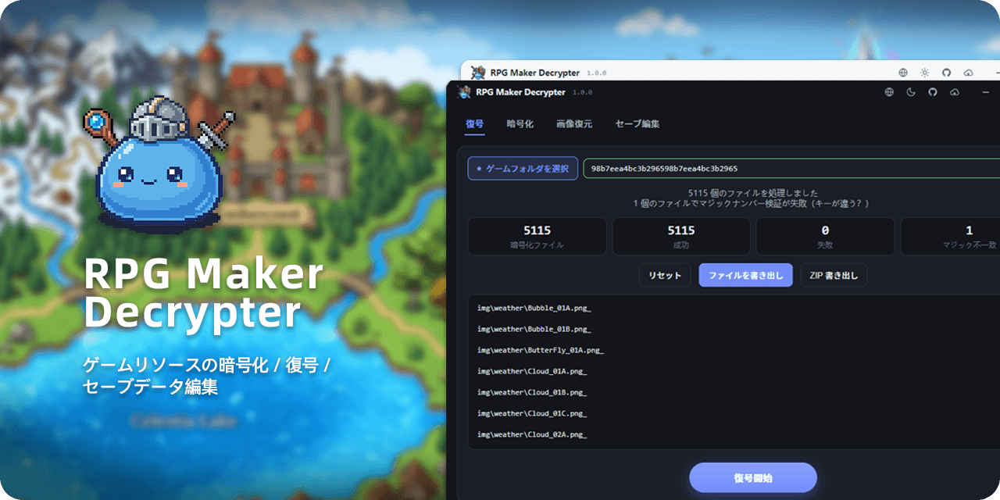

<div align="center">

<p></p>

<p>
<a href="https://github.com/LynxShu/RPGMakerDecrypter/releases"></a>&nbsp;
<a href="https://github.com/LynxShu/RPGMakerDecrypter/releases"></a>&nbsp;
<a href="https://github.com/LynxShu/RPGMakerDecrypter/releases"></a>&nbsp;
<a href="https://github.com/LynxShu/RPGMakerDecrypter/blob/main/LICENSE"></a>
</p>

<h3><p><a href="README.md">简体中文</a> &nbsp; / &nbsp; <a href="README_en.md">English</a> &nbsp; / &nbsp; 日本語</p></h3>

**RPG Maker MV / MZ** ゲームリソースの復号・暗号化ツール

</div>


## 📖 1. プロジェクト概要

- 本ツールは、RPG Maker MV / MZ ゲームのリソースを復号・再暗号化します。自分で失ったプロジェクトファイルの復元、許可を得た改造（Modding）、学習・研究を目的としています。
- さらなる機能と使い勝手の改善を継続して行っています…

> [!TIP]
> 旧 Python 版のプログラムソースはアーカイブ済みです。ご利用の場合は [Original Build](https://github.com/LynxShu/RPGMakerDecrypter/releases/tag/v0.1-beta.1) をダウンロードしてください。

## ✨ 2. 機能

- **復号 / 暗号化**：MV の `.rpgmvp / .rpgmvo / .rpgmvm` と MZ の `.png_ / .ogg_ / .m4a_` リソースファイル。
- **画像復元**：暗号化キーがなくても PNG ファイルヘッダーを再構築して画像を復元できます。
- **キー推測**：`System.json`、`rpg_core.js`、または暗号化画像ヘッダーからキーを推測します。
- **一括処理と性能**：マルチスレッド復号、リアルタイム進捗、キャンセル可能、ファイルごとのタイムアウトで自動スキップ。超大容量ディレクトリはストリーミングスキャンと段階的レンダリングに対応。
- **エクスポート**：復号結果をフォルダーに書き出すか、`ZIP` に圧縮できます。
- **多言語**：中文 / English / 日本語を内蔵し、**カスタム言語パック**に対応。
- **テーマ**：ライト / ダークテーマ。
- **コマンドライン**：バッチ自動化に便利な完全な CLI。

## ⚡ 3. クイックスタート

1. **ダウンロード**：[GitHub Releases](https://github.com/LynxShu/RPGMakerDecrypter/releases) を開き、圧縮ファイルをダウンロードします。
2. **解凍**：任意のフォルダーに解凍します（`C:\Program Files` など管理者権限が必要な場所は避けてください）。
3. **実行**：解凍したフォルダー内の `RPGMakerDecrypter.exe` をダブルクリックして起動します。

## 🚀 4. 使い方

### 1️⃣ リソースの復号

1. ゲームフォルダーを選択し「復号を開始」をクリック — 暗号化ファイルのスキャン、キーの検出、キー事前チェックを自動で行います。
2. 統計を確認後、「ファイルをエクスポート」（フォルダーへコピー）または「ZIP をエクスポート」（圧縮）を選択します。
3. 「リセット」で今回のキャッシュをクリアします。

### 2️⃣ 暗号化 / キーなし画像復元

対応するタブに切り替え、ファイル/フォルダーと出力先フォルダーを選択し、単体/一括処理を行います。

### 3️⃣ コマンドライン（CLI）

```bash
# リソース
rpgmaker-decrypter decrypt <file> -k <key> [-o out] [--json]
rpgmaker-decrypter encrypt <file> -k <key> [-o out]
rpgmaker-decrypter restore <file> [-o out]                        # キーなし画像復元
rpgmaker-decrypter detect-key <dir>                               # キーを自動検出
rpgmaker-decrypter decode-dir <dir> [-k key] [-o out] [--dry-run] [--jobs 8]
```

共通オプション：`--json`（機械可読出力）、`--verbose`（詳細情報）、`--lang <code>`（UI 言語。見つからない場合は英語にフォールバック）。

開発環境では `rpgmaker-decrypter` の代わりに `npm run cli -- <args>` を使用できます。

## 🌐 5. カスタム言語パック

言語パックは JSON ファイルです。プロジェクトには完全なテンプレートが付属しており、編集すると**即時に反映され、アプリの再起動は不要**です。

### 言語の追加

1. **コピー**：`_template.json` をコピーし、対象の言語名にリネームします（例：`fr.json`、`de.json`）。
   - ソース版：テンプレートはプロジェクトルートの `locales/_template.json` にあります。
   - パッケージ版（ポータブル版）：テンプレートは `<プログラムフォルダー>\rpgmaker-decrypter\locales\` にあります。
   - プログラムフォルダーに書き込めない場合（`C:\Program Files` や読み取り専用ドライブなど）は、`%APPDATA%\rpgmaker-decrypter\locales\` にフォールバックします。
2. **名前変更**：ファイル先頭の `"__meta": { "name": "…" }` を言語名に変更します（右上の言語ドロップダウンに表示されます）。例：`"Français"`。
3. **翻訳**：各キーの後の引用符内の英文を自分の言語に置き換えて保存します。ドロップダウンにすぐに新しい言語が表示されます。

> [!NOTE]
> テンプレートには**すべて**のメッセージキーが含まれています。変更したいキーだけを残しても構いません。存在しないキーは自動的に英語へフォールバックします。

## 💾 データの保存場所（ポータブルモード）

Windows のパッケージ版（ポータブル版）は、アプリのデータを `<プログラムフォルダー>\rpgmaker-decrypter\` に保存します。フォルダーごと USB メモリや外付けドライブに持ち運べます：

| パス | 内容 |
| --- | --- |
| `config.json` | UI 言語・テーマなどの設定 |
| `history.json` | 最近のプロジェクトとキーの履歴 |
| `locales\` | カスタム言語パック（前のセクションを参照） |
| `cache\` | 復号の一時キャッシュ。終了時 / 起動時に自動でクリーンアップ |

- **フォールバック**：プログラムフォルダーに書き込めない場合（`C:\Program Files` や読み取り専用ドライブなど）は、代わりにシステム既定の `%APPDATA%\rpgmaker-decrypter\` を使用します。
- **初回のポータブル起動時**：対象フォルダーが存在しなかった場合、`%APPDATA%\rpgmaker-decrypter` にある既存の `config.json`、`history.json`、`locales\` を移行します。不足している項目のみを補い、既存のファイルは上書きしません。
- **環境変数による上書き**：絶対パスの環境変数 `RPGMD_DATA_DIR` を設定すると、どのモードでもデータディレクトリを強制的に指定できます。開発モードで未設定の場合はシステム既定のディレクトリを使用します。
- **キャッシュ**：ポータブルモードではデータフォルダーの `cache\`、それ以外では `%TEMP%\rpgmaker-decrypter` に置かれます。
- macOS / Linux にはポータブルモードがなく、常にシステム既定のデータフォルダーを使用します。

## 🧪 開発とテスト

```bash
npm run typecheck    # TypeScript 型チェック
npm test             # vitest ユニットテスト
node scripts/verify.cjs               # コア自己チェック（先に tsc -p tsconfig.build-lib.json を実行）
node scripts/regression.cjs           # 合成サンプルでのエンドツーエンド
node scripts/verify-cli.cjs           # CLI 自動化（先に prepare-cli-test.cjs を実行）
node scripts/verify-watch.cjs         # ホットリロード / 設定保存のリグレッション
```

### 必要環境と実行
- Node.js ≥ 20（22 推奨）
- npm ≥ 10

```bash
npm install          # 依存関係のインストール
npm run dev          # 開発実行（ホットリロード）
npm run build        # out/ にビルド
npm run package:dir  # ポータブルフォルダー release/win-unpacked/ を生成（.exe を含む）
npm run package      # インストーラー（NSIS）を生成
```

## 🤝 謝辞

本プロジェクトは設計・実装において以下のオープンソースプロジェクトを参考にしています：

- [Petschko/RPG-Maker-MV-Decrypter](https://github.com/Petschko/RPG-Maker-MV-Decrypter)
- [pieroxy/lz-string](https://github.com/pieroxy/lz-string)
- [RPG-Maker-Translation-Tools/rpgmdec](https://github.com/RPG-Maker-Translation-Tools/rpgmdec)
- [RPG-Maker-Translation-Tools/rpgm-archive-decrypter](https://github.com/RPG-Maker-Translation-Tools/rpgm-archive-decrypter)
- [RPG-Maker-Translation-Tools/rpgm-asset-decrypter-rs](https://github.com/RPG-Maker-Translation-Tools/rpgm-asset-decrypter-rs)
- [Petschko/Java-RPG-Maker-MV-Decrypter](https://github.com/Petschko/Java-RPG-Maker-MV-Decrypter)
- [omega-slender/NimRpgMakerDecrypt](https://github.com/omega-slender/NimRpgMakerDecrypt)

## ⚖️ 免責事項

> [!WARNING]
> **本ツールは学習・研究、ファイル復元、許可を得た改造（Modding）のみを目的としています。**

- 本ツールを使用してリソースを盗用したり、ゲーム開発者の知的財産権を侵害したりしないでください。
- 対象のソフトウェアやゲームの著作権および利用規約を尊重してください。
- 本ソフトウェアの使用によって生じた悪用や法的結果について、作者は一切の責任を負いません。

## 📜 ライセンス

本プロジェクトは **MIT** ライセンスで提供されています。
