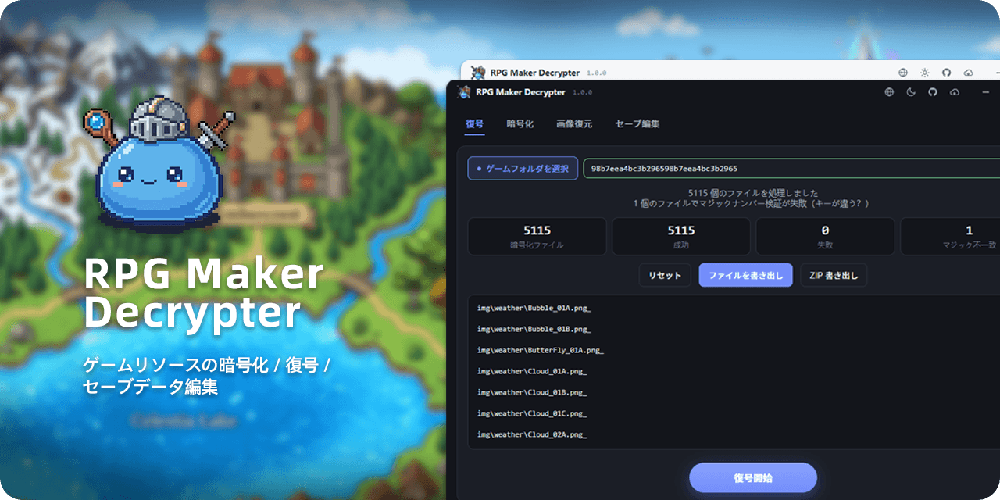

<div align="center">

<p></p>

<p>
<a href="https://github.com/LynxShu/RPGMakerDecrypter/releases"></a>&nbsp;
<a href="https://github.com/LynxShu/RPGMakerDecrypter/releases"></a>&nbsp;
<a href="https://github.com/LynxShu/RPGMakerDecrypter/releases"></a>&nbsp;
<a href="./skills/rpgmaker-decrypter/SKILL.md"></a>&nbsp;
<a href="https://github.com/LynxShu/RPGMakerDecrypter/blob/main/LICENSE"></a>
</p>

<h3><a href="README.md">简体中文</a> &nbsp; / &nbsp; <a href="README_en.md">English</a> &nbsp; / &nbsp; 日本語</h3>

**RPG Maker MV / MZ** リソース復号・暗号化・キーなし画像復元・プロジェクト復元ツール

</div>

> [!NOTE]
> `v1.0.3` は本プロジェクトの機能完結版（最終リリース）です。今後はメンテナンスモードに移行し、原則として新規機能の追加は行いません。
> 旧 Python 版ソースはアーカイブ済みです。必要な場合は [Original Build (v0.1-beta.1)](https://github.com/LynxShu/RPGMakerDecrypter/releases/tag/v0.1-beta.1) をご利用ください。

---

## ✨ 機能一覧

| 機能 | 内容 |
| --- | --- |
| **リソース復号 / 暗号化** | MV（`.rpgmvp / .rpgmvo / .rpgmvm`）および MZ（`.png_ / .ogg_ / .m4a_`）の画像・音声リソースに対応 |
| **プロジェクト書き出し** | MV / MZ 配布版からエディターで直接開ける `<フォルダ名>_project` を復元（NW.js ランタイム除外・`System.json` 暗号化フラグ解除・`.rpgproject` / `.rmmzproject` 自動生成・プラグイン独自フォルダ保持・元フォルダ非変更） |
| **キーなし画像復元** | 暗号化キーがなくても標準 PNG ヘッダーを再構築して暗号化画像を復元 |
| **キー自動検出** | `System.json` → `rpg_core.js` → 暗号化 PNG ヘッダー逆算の優先順で自動検出し、復号結果をマジックナンバーで検証 |
| **高速バッチ処理** | マルチスレッド復号、リアルタイム進捗、即時キャンセル、ファイル単位タイムアウト、大容量フォルダのストリーミングスキャンと仮想リスト描画 |
| **柔軟な書き出し** | フォルダへのファイル書き出し、`ZIP` 圧縮、編集可能プロジェクトとしての復元に対応 |
| **多言語 & テーマ** | 簡体字中国語 / 繁體中文 / English / 日本語を内蔵（初回起動時にシステム言語を自動判定）、カスタム言語パックのホットリロード・ライト/ダークテーマ対応 |
| **CLI & AI Skill** | 本格的なコマンドラインツールに加え、AI エージェント向けの [AI Skill](skills/rpgmaker-decrypter/SKILL.md) を同梱 |

---

## ⚡ 使用方法

### 1. デスクトップ版（推奨・Windows ポータブル版）

1. [GitHub Releases](https://github.com/LynxShu/RPGMakerDecrypter/releases) から最新の ZIP アーカイブをダウンロードします。
2. 書き込み可能な任意のフォルダへ解凍します（`C:\Program Files` など管理者権限が必要な場所は避けてください）。
3. `RPGMakerDecrypter.exe` をダブルクリックして起動します。

**基本操作**
- **復号 / プロジェクト書き出し**：ゲームフォルダを選択 →「復号開始」（自動スキャン・キー検出・キャッシュへ復号）→ 用途に応じて「ファイルを書き出し」「プロジェクト書き出し」「ZIP 書き出し」を実行 → 完了後は「出力フォルダを開く」から直接確認できます。「リセット」でキャッシュを消去します。
  > 暗号化されていない完全な MV / MZ ゲームも、スキャン後にそのまま「プロジェクト書き出し」を実行できます。
- **暗号化 / 画像復元**：該当タブに切り替え、ファイルまたはフォルダと出力先を指定して一括処理します。

### 2. コマンドライン（CLI）

一括自動化やスクリプト連携に適しています（開発環境では `npm run cli -- <コマンド>`、ビルド後は `node out/main/cli.js <コマンド>` を使用）：

```bash
# ゲームフォルダから暗号化キーを自動検出
rpgmaker-decrypter detect-key <dir>

# ゲームフォルダ全体を一括復号（キー自動検出・ディレクトリ構造保持）
rpgmaker-decrypter decode-dir <dir> [-k <key>] [-o <out>] [--dry-run] [--jobs 8] [--json]

# MV/MZ 配布版を編集可能なプロジェクトに復元（既定では同階層の <フォルダ名>_project に出力）
rpgmaker-decrypter export-project <dir> [-k <key>] [-o <out>] [--dry-run] [--jobs 8] [--json]

# 単一ファイルの復号 / 暗号化 / キーなし画像復元
rpgmaker-decrypter decrypt <file> -k <key> [-o <out>] [--ignore-fake-header] [--json]
rpgmaker-decrypter encrypt <file> -k <key> [-f mv|mz] [-o <out>] [--json]
rpgmaker-decrypter restore <file> [-o <out>] [--json]
```

共通オプション：`--json`（JSON 出力、サブコマンドの前後どちらでも指定可能）、`--verbose`（詳細ログ）、`--lang <code>`（表示言語、未検出時は英語にフォールバック）。

### 3. AI アシスタントと連携（AI Skill）

Claude Code、Codex、Cursor、Antigravity などの AI コーディングエージェントから直接処理したい場合、本リポジトリ同梱の Skill をそのまま利用できます：

- パス：[`skills/rpgmaker-decrypter/SKILL.md`](skills/rpgmaker-decrypter/SKILL.md)

この Skill には RPG Maker MV / MZ の疑似ヘッダー仕様、XOR ルール、キー逆算、PNG ヘッダー復元、プロジェクト復元の手順と標準ライブラリのみの Python リファレンス実装が含まれており、AI が原理に基づいて直接スクリプトを実行したり、本リポジトリの CLI を呼び出して処理できます。

---

## 🌐 カスタム言語パック

言語パックは標準 JSON ファイルで、編集すると**アプリを再起動せず即座に反映**されます。

1. テンプレート `_template.json` を開きます：
   - ポータブル版：`<実行フォルダ>\rpgmaker-decrypter\locales\_template.json`（書き込み不可の場合は `%APPDATA%\rpgmaker-decrypter\locales\`）
   - ソース版：`locales/_template.json`
2. コピーして言語コード名にリネームします（例：`fr.json`、`ko.json`）。
3. 先頭の `"__meta": { "name": "…" }` にメニュー表示名を設定し、必要な項目を翻訳して保存します。未翻訳のキーは自動的に英語へフォールバックされます。

---

## 💾 データ保存場所

Windows ポータブル版では設定やキャッシュが `<実行フォルダ>\rpgmaker-decrypter\` にまとめて保存され、USB メモリ等でそのまま持ち運べます：

| パス | 用途 |
| --- | --- |
| `config.json` | 言語・テーマなどの設定 |
| `history.json` | 最近のプロジェクトとキー履歴 |
| `locales\` | カスタム言語パック |
| `cache\` | 復号用一時キャッシュ（終了時・次回起動時に自動削除） |

- **自動フォールバック**：`Program Files` などの読み取り専用フォルダに置かれた場合、自動的に `%APPDATA%\rpgmaker-decrypter\` へ切り替わります（キャッシュは `%TEMP%\rpgmaker-decrypter`）。
- **環境変数による上書き**：環境変数 `RPGMD_DATA_DIR` に絶対パスを設定すると、すべてのモードでデータ保存先を固定できます。

---

## 🧪 開発・ビルド

動作環境：Node.js ≥ 20（22 推奨）、npm ≥ 10。

```bash
npm install          # 依存関係をインストール
npm run dev          # 開発モード（ホットリロード）
npm run typecheck    # TypeScript 型チェック
npm test             # Vitest ユニットテスト
npm run cli:test     # CLI 自動検証
npm run build        # アプリと CLI を out/ へビルド
npm run package:dir  # Windows ポータブル版を release/win-unpacked/ へ生成
```

---

## 🤝 謝辞

本プロジェクトの設計・実装にあたり、以下のオープンソースプロジェクトを参考にしました：

- [Petschko/RPG-Maker-MV-Decrypter](https://github.com/Petschko/RPG-Maker-MV-Decrypter)
- [pieroxy/lz-string](https://github.com/pieroxy/lz-string)
- [RPG-Maker-Translation-Tools/rpgmdec](https://github.com/RPG-Maker-Translation-Tools/rpgmdec)
- [RPG-Maker-Translation-Tools/rpgm-archive-decrypter](https://github.com/RPG-Maker-Translation-Tools/rpgm-archive-decrypter)
- [RPG-Maker-Translation-Tools/rpgm-asset-decrypter-rs](https://github.com/RPG-Maker-Translation-Tools/rpgm-asset-decrypter-rs)
- [Petschko/Java-RPG-Maker-MV-Decrypter](https://github.com/Petschko/Java-RPG-Maker-MV-Decrypter)
- [omega-slender/NimRpgMakerDecrypt](https://github.com/omega-slender/NimRpgMakerDecrypt)

---

## ⚖️ 免責事項

> [!WARNING]
> **本ツールは、自身が失ったプロジェクトの復元、学習・研究、および許可を得たローカライズ・改造（Modding）のみを目的としています。**

- ゲーム開発者の知的財産権を侵害する行為やリソースの不正取得には使用しないでください。
- 対象となるソフトウェア・ゲームの著作権および利用規約を尊重してください。
- 本ソフトウェアの不適切な使用によって生じたいかなる法的責任・損害についても、作者は一切責任を負いません。

## 📜 ライセンス

本プロジェクトは **MIT** ライセンスの下で公開されています。詳細は [LICENSE](LICENSE) をご覧ください。
